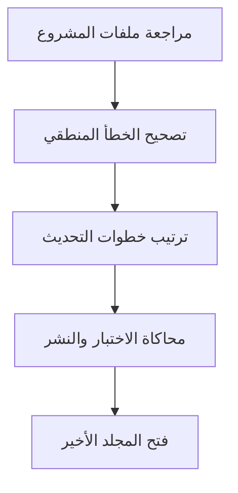
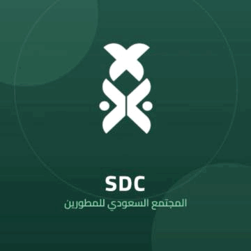

# آخر إصدار | Athar Game

لعبة تقنية تفاعلية أعددتها لختام ورشة المجتمع السعودي للمطورين حول الفروق التقنية بين بيئات العمل في الشركات والبنوك وأساسيات Git وGitHub.

صممت التجربة داخل واجهة تحاكي سطح المكتب، ليطبق المشاركون بعض أفكار الورشة من خلال تحديات قصيرة.

## فكرة اللعبة

يمر المشارك بثلاثة تحديات، ثم يكمل محاكاة الاختبار والنشر لفتح المجلد الأخير.

- مراجعة ملفات المشروع واختيار الملفات المناسبة للرفع.
- استبعاد الملفات الحساسة والملفات غير اللازمة للمستودع.
- اكتشاف خطأ منطقي في الكود وتصحيحه.
- ترتيب خطوات تحديث برمجي.

## مسار التجربة

تنتهي التجربة بمقطع يحمل رسالة المجتمع:

**بعلمنا وعملنا نبني وطننا**

## التقنيات

| التقنية | الاستخدام |
|---|---|
| HTML وCSS | بناء الواجهات وتنسيقها |
| JavaScript | إدارة التحديات والتفاعل وحالة اللعبة |
| Three.js | عرض المشهد ثلاثي الأبعاد |
| Blender | إعداد نموذج الحاسب |

## المفاهيم

Git · GitHub · مراجعة الملفات · حماية الأسرار البرمجية · تصحيح الأخطاء · خطوات إصدار البرمجيات

أوامر الاختبار والنشر داخل اللعبة محاكاة تعليمية، ولا تنفذ أوامر على جهاز المشارك أو تتصل بمستودعاته.

## تجربة اللعبة

[تشغيل اللعبة](https://reembalshammari.github.io/Athar-game/)

وصلت للنهاية؟ صوّر إنجازك وشاركه في المجتمع السعودي للمطورين.

---

<table>
  <tr>
    <td width="90">
      
    </td>
    <td>
      <strong>المجتمع السعودي للمطورين</strong> 
      فكرة وإعداد وتنفيذ: ريم بريكان الشمري 
      قائدة لجنة التقنية والتطوير
    </td>
  </tr>
</table>
